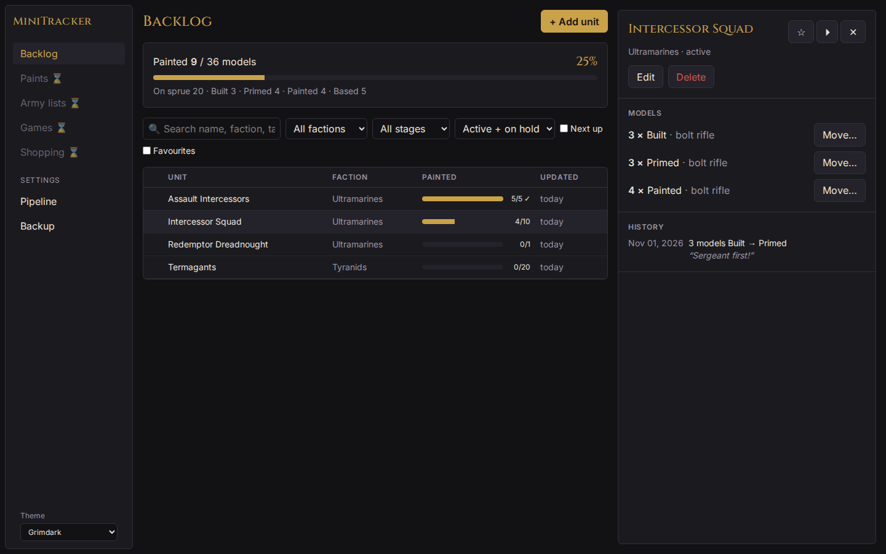
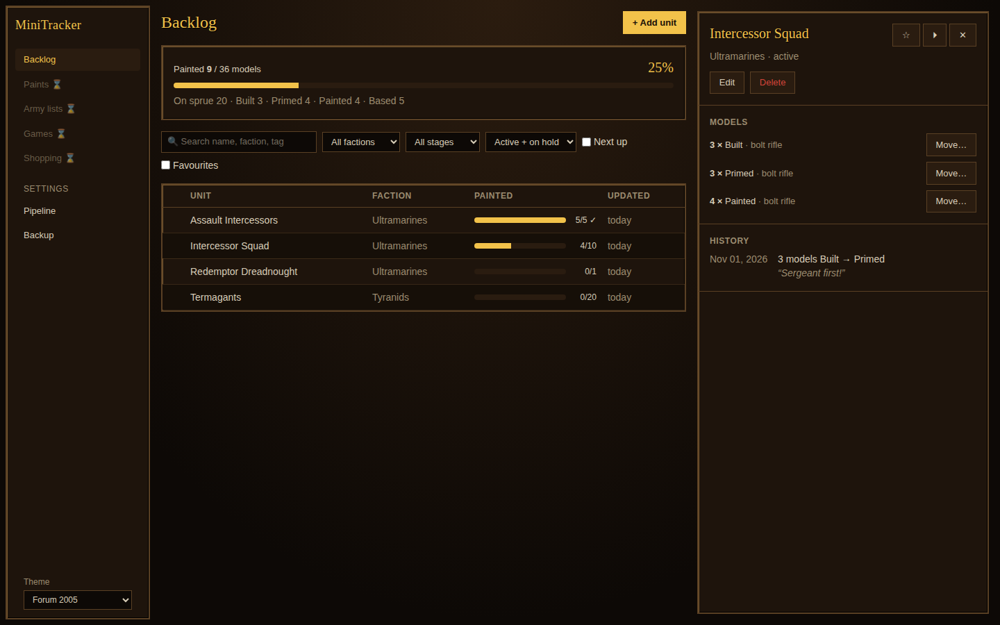
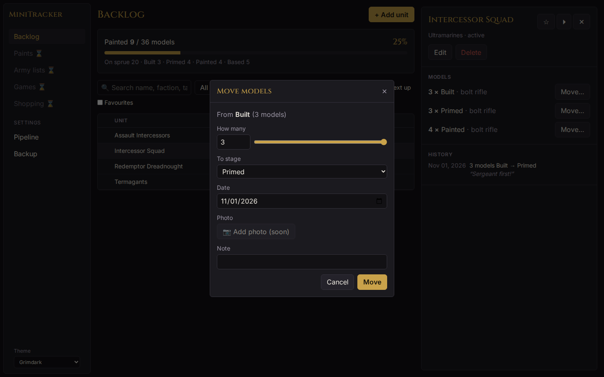

# MiniTracker

**Track your miniature backlog, from sprue to varnish, and (soon) build armies from the models you actually own.**

[](https://github.com/Giacomo-Antonioli/MiniTracker/actions/workflows/ci.yml)
[](https://github.com/Giacomo-Antonioli/MiniTracker/actions/workflows/deploy.yml)
[](https://github.com/Giacomo-Antonioli/MiniTracker/releases)
[](LICENSE.md)

### ▶ [Open the app](https://giacomo-antonioli.github.io/MiniTracker/) · 📖 [User guide](docs/USER_GUIDE.md)

No account, no server: your collection stays in your browser. Install it from the browser menu ("Install app" / "Add to Home Screen") and it works offline on desktop, iPad and phone.



## Features

**Collection**

- **Home dashboard.** Pile size, painted this month, streak, finish estimate, the units to continue, a year activity calendar, records, recent moves, games, shopping and running-low items. Reorder, resize, add or remove cards (✎ Customise).
- **Units with model groups.** "6 built + 4 painted" in one unit, each group with its own loadout and magnetised weapon slots; Wishlisted models you don't own yet.
- **Painting pipeline.** Move models through your stages (wishlisted → sprue → built → primed → basecoated → painted → based → varnished), with a quick move on each row. Rename, reorder or add stages.
- **History and photos.** Every move is saved with date, note and photo; a photo timeline per unit shows it from bare plastic to finished.
- **Backlog.** Grouped table with stage bars, sortable and hideable columns, filters, side panel and unit page.
- **Stats.** Models painted per month or week, pile in vs out, pile size and age, points painted, where the work goes, time per stage, painted by faction and role, spending, paint usage, records and game results.

**Catalogue and rules**

- **Unit catalogue.** Every Warhammer 40,000 datasheet (10th and/or 11th edition), Age of Sigmar 4th edition and Kill Team (2024) from BSData, Middle-earth (2024) from the MESBG list builder, and every Age of Sigmar Spearhead box to add in one go, downloaded and converted on your device: sizes, points, stats, weapons, abilities, wargear.
- **Rules.** Every core and faction rule explained, in the catalogue and on a searchable Rules page.
- **Stratagems.** Import Wahapedia's stratagem and detachment-rule files once; they show on the army PDF and in the match companion.

**Armies and games**

- **Army lists.** Build lists for 10th or 11th edition from legal units of your faction: detachments, enhancements, one Warlord (only Characters), Leaders, wargear loadouts. Owned / partly owned / missing per unit and painted progress.
- **Rule checks.** Points, unit limits, detachment points, enhancements, Leaders and Warlord, read from BSData for each edition; hover a warning for the rule behind it.
- **Army PDF.** Roster, datasheet cards (stats, weapons the loadout carries, abilities), a legend of every rule and keyword, and stratagem cards; owned/painted counts only if you ask.
- **Buy list.** What you still need for a list (models and scheme paints), as text, PDF or straight to the shopping list.
- **Import / export.** BattleScribe and NewRecruit rosters (`.rosz`), GW-app / NewRecruit text lists, and MiniTracker files.
- **Games.** Live score board (primary and secondary per round, CP, turns, units destroyed on both sides, opponent's list), history and results per list and opponent faction.
- **Match companion.** Phone-friendly screen for a game: phase bar, stratagems you can use now, abilities for the phase and turn, wounds per model, chess clock, photos.
- **Game tools.** 3D dice for hits, wounds and saves; roll-off or coin flip for who goes first; 40k mission cards (Force Dispositions, Primary Missions, Deployment, Twist); the opponent's list from a file, your lists or by QR.

**Paints and shopping**

- **Schemes.** Official, community and personal paint schemes with variants, a credited library of community recipes, and a **Send to MiniTracker** bookmarklet.
- **Paints.** ~1,500 Citadel, Army Painter, Vallejo and AK paints with swatches; inventory with stages, pots, price, shop and notes; CSV import/export; paints missing for your schemes.
- **Shopping lists.** One main list plus your own lists; models, paints and anything else, with shop and price; ticking a kit bought moves its models into your collection.
- **Supplies.** Primer, glue, brushes… with stock and an alert level. Paints marked running low and supplies at their alert level go on the shopping list.

**Everywhere**

- **Sync.** Between your own devices by pairing code, QR carousel (no network) or a sync file.
- **Share.** A read-only link to your collection and painting progress, with the data inside the link.
- **Backup.** Everything (photos included) in one file; restore it on any device.
- **Themes.** *Grimdark* (modern dark) and *Forum 2005* (old-school fantasy forum).
- **Private.** Your collection, lists and games stay in your browser; there is no account or server.

| Forum 2005 theme | Moving models |
|---|---|
|  |  |

## Roadmap

Released: collection tracker (v0.1), catalogue (v0.2), paints, schemes and photos (v0.3), army builder (v0.4), loadouts and shopping (v0.5), Home and Stats (v0.6), stratagems, supplies and photo timeline (v0.7), games and match companion (v0.8), colour match, magnets and cost tracking (v0.9), goals, recipe links and share links, bigger scheme library (v0.10), guides: techniques, bases, materials, terrain; more paint brands (v0.11), painting time + companions (v0.12), storage + QR labels (v0.13), barcode scanner (v0.14), tools and per-model labels (v0.15), workshop and mass move (v0.16), liquid levels and settings tabs (v0.17), device sync and phone layout (v0.18), QR carousel sync (v0.19), Sync now with known devices (v0.20), game tools: 3D dice, roll-off, mission cards, opponent list by QR (v0.21), share link, Age of Sigmar and Kill Team, user guide (v0.22), Middle-earth and game picker (v0.23), Spearhead boxes (v0.24), Middle-earth wargear options (v0.25). See the [changelog](CHANGELOG.md).

Next, from the [open issues](https://github.com/Giacomo-Antonioli/MiniTracker/issues): magnet editor ([#32](https://github.com/Giacomo-Antonioli/MiniTracker/issues/32)), closest paint match ([#30](https://github.com/Giacomo-Antonioli/MiniTracker/issues/30)), cost tracking ([#94](https://github.com/Giacomo-Antonioli/MiniTracker/issues/94)), Kanban board ([#91](https://github.com/Giacomo-Antonioli/MiniTracker/issues/91)), painting time ([#89](https://github.com/Giacomo-Antonioli/MiniTracker/issues/89)), storage boxes ([#18](https://github.com/Giacomo-Antonioli/MiniTracker/issues/18)). Later: more paint brands, barcode scan, share links, a buy optimiser, Kill Team / Age of Sigmar, QR/NFC tags, phone layout.

## How it works

```
React UI (features/)  →  domain logic (pure TypeScript)  →  repositories  →  IndexedDB in your browser
```

- **`src/domain/`**: all the rules (groups, pipeline, progress, filters). No React, no storage, heavily tested.
- **`src/data/`**: storage behind small repository interfaces, so sync or a desktop backend can plug in later.
- **`src/features/`**: one folder per screen.

**Stack:** React 19, TypeScript, Vite, Tailwind CSS, Zustand, Dexie (IndexedDB), vite-plugin-pwa. Tests with Vitest, Testing Library and Playwright.

## Development

Needs Node.js 24.

```bash
git clone https://github.com/Giacomo-Antonioli/MiniTracker.git
cd MiniTracker
npm install
npm run dev            # http://localhost:5173/MiniTracker/
```

| Command | What it does |
|---|---|
| `npm run dev` | Dev server with hot reload |
| `npm test` | Unit and component tests |
| `npm run test:coverage` | Tests with coverage (fails under 90% on domain/data) |
| `npm run e2e` | Playwright end-to-end tests (desktop + iPad viewports) |
| `npm run check:bsdata` | Live check: download real BSData and parse it (needs internet) |
| `npm run lint` / `npm run typecheck` | Static checks |
| `npm run build` | Production build into `dist/` |

### Workflow

Work is planned in two-week sprints on [GitHub issues](https://github.com/Giacomo-Antonioli/MiniTracker/issues) grouped by milestone. Each issue gets a branch and a pull request; CI (lint, typecheck, tests, coverage, build, end-to-end) must pass before merging. Every merge to `main` deploys the app to GitHub Pages.

### Releasing

1. Move the `[Unreleased]` entries in [CHANGELOG.md](CHANGELOG.md) under a new `## [x.y.z] - YYYY-MM-DD` heading.
2. Set the same version: `npm version x.y.z --no-git-tag-version`.
3. Merge that to `main`, then tag it: `git tag vx.y.z && git push origin vx.y.z`.
4. The [Release workflow](.github/workflows/release.yml) checks the version, runs the tests, builds, and publishes a GitHub release with the changelog section and a zip of the web app. Tags with a suffix (e.g. `v0.2.0-beta.1`) become pre-releases.

## Contributing

Bug reports and ideas are welcome as [issues](https://github.com/Giacomo-Antonioli/MiniTracker/issues/new/choose). Pull requests should follow the PR template checklist.

## Credits

- Paint list: [minipainter](https://github.com/ArturSkowronski/minipainter) by Artur Skowronski (MIT) and [miniature-paints](https://github.com/Arcturus5404/miniature-paints) by Rick Fleuren (MIT, Green Stuff World, Scale75 and Pro Acryl), see [THIRD_PARTY_NOTICES.md](THIRD_PARTY_NOTICES.md).
- Scheme library: recipe facts (areas, steps, paints) from community authors on [Paint Pad](https://paintpad.app), ['Eavy Archive](https://eavy-archive.com) and [Tale of Painters](https://taleofpainters.com), each credited and linked to its source inside the app. No text or images are copied. Authors who want a recipe removed can [open an issue](https://github.com/Giacomo-Antonioli/MiniTracker/issues/new/choose). Rebuilt with `npm run schemes:scrape` (polite: identifies itself, waits between requests, respects robots.txt and sites that block bots).
- Unit and points data: the community-maintained [BSData](https://github.com/BSData) files ([wh40k-10e](https://github.com/BSData/wh40k-10e)). MiniTracker does not include or redistribute this data: each user's browser downloads it from BSData. A [daily check](.github/workflows/bsdata-check.yml) makes sure the download still works.
- Stratagems and detachment rules: [Wahapedia](https://wahapedia.ru)'s data export. Not included in MiniTracker: each user downloads the files and imports them. Powered by Wahapedia.

## License

[PolyForm Noncommercial 1.0.0](LICENSE.md). Free to use, study, modify and share for noncommercial purposes, keeping the copyright notice. No commercial use. Provided as is, with no warranty or liability.

Because commercial use is not allowed, this is *source-available* rather than OSI "open source".

## Disclaimer

MiniTracker is an unofficial fan project, not affiliated with or endorsed by Games Workshop. Warhammer, Warhammer 40,000 and related names are trademarks of Games Workshop Ltd. No Games Workshop artwork or rules text is included.
